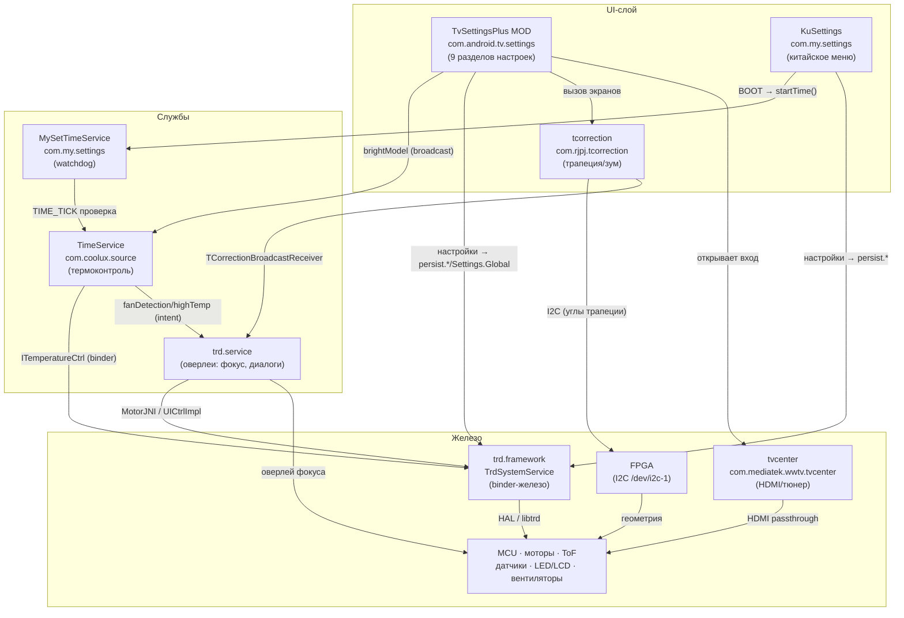

# ГЛОБАЛЬНАЯ КАРТА СИСТЕМЫ ПРОЕКТОРА FlixTone D11 (8054)

Дата: 2026-11-27. Собрано по всем отчётам проекта.
Цель: единая карта связей между системными программами, которые управляют проектором.

> Охват: только программы, управляющие/настраивающие проектор. Исключены:
> zxlauncher/zxstore, toofifi (AirPlay), yunota (OTA), медиаплеер, заводские тесты.

---

## 0. Участники (7 программ)

| Пакет | APK / имя | Роль | Судьба |
|---|---|---|---|
| `com.android.tv.settings` | TvSettingsPlus (+ MOD 2.28) | **Главные настройки** (наш интерфейс) | целевой |
| `com.my.settings` | KuSettings | китайское меню + **watchdog** | вырезать после переноса |
| `com.coolux.source` | KuSourceRJ → Protection | **термоконтроль**, вентиляторы, яркость | модернизирован |
| `com.trd.framework` | trdmiddle | **binder-сервис железа** (TrdSystemService) | не трогаем |
| `com.trd.service` | trdservice | **оверлеи** (фокус, диалоги), JNI-моторы | модернизирован |
| `com.rjpj.tcorrection` | KeystoneCorrection | **экраны трапеции/зума** (I2C/FPGA) | перенести в MOD |
| `com.mediatek.wwtv.tvcenter` | tvcenter | **ТВ/HDMI вход** (тюнер, passthrough) | не трогаем |

---

## 1. Слои (упрощённая архитектура)

```
┌─────────────────────────────────────────────────────────────────┐
│  UI-слой (Activity/Fragment)                                    │
│  TvSettingsPlus MOD · KuSettings · tcorrection                  │
└───────────────┬─────────────────────────────────────────────────┘
                │ intent / binder / broadcast / persist
┌───────────────▼─────────────────────────────────────────────────┐
│  Службы (Service/Receiver)                                      │
│  KuSource.TimeService · KuSettings.MySetTimeService ·           │
│  trd.service (UICtrlImpl, MotorJNI)                              │
└───────────────┬─────────────────────────────────────────────────┘
                │ binder (AIDL)
┌───────────────▼─────────────────────────────────────────────────┐
│  Железный слой                                                  │
│  trd.framework (TrdSystemService) · tvcenter · FPGA(I2C)        │
└───────────────┬─────────────────────────────────────────────────┘
                │ HAL / I2C / lib
┌───────────────▼─────────────────────────────────────────────────┐
│  MCU · моторы · ToF · датчики · LED/LCD · вентиляторы           │
└─────────────────────────────────────────────────────────────────┘
```

---

## 2. Поток при загрузке (BOOT)

```
BOOT_COMPLETED
  │
  ├─[priority 1000]─ com.my.settings.BootupReceiver (KuSettings)
  │     └─ startMyTimeService()
  │           └─ MySetTimeService (watchdog)
  │                 ├─ TIME_TICK (раз в минуту)
  │                 └─ TimeServiceSourceHasStart() ?
  │                        ├─ нет → startSourceTimeService()
  │                        └─ да → (ничего)
  │
  ├─ com.coolux.source.BootupReceiver (Protection)
  │     └─ defaultInit → defaultBright → UtilsTools.startTime()
  │           └─ TimeService (термоконтроль)
  │
  └─ com.android.tv.settings (MOD) — KuSourceRecoveryBootReceiver
        └─ KuSourceRecoveryService (свой watchdog, пока 8052-only)
```

**Ключевая связь:** `KuSettings.MySetTimeService` — это watchdog для
`KuSource.TimeService` (`START_NOT_STICKY`, сам не перезапускается).
Пока KuSettings не удалён — он поднимает TimeService при падении.

---

## 3. Центральный узел: trd.framework (TrdSystemService)

Всё железо доступно через binder `TrdSystemService`. Публичные интерфейсы:

| Интерфейс | Функция |
|---|---|
| `IMotorCtrl` | моторы: фокус, трапеция, зум |
| `IProjectorCtrl` | режим проектора (потолок/тыл) |
| `ITofCtrl` | ToF-датчик (автофокус, автотрапеция) |
| `ITemperatureCtrl` | температура LED/LCD/AMB, вентиляторы |
| `ISensorCtrl` | акселерометр, гироскоп |
| `ISystemCtrl` | системные команды (яркость `setBacklight`) |
| `ICommunicationCtrl` | связь с MCU |

Через него идут: KuSettings, KuSource (термо), tcorrection (частично), trd.service.

---

## 4. Полная карта связей (Mermaid)



---

## 5. Таблица: кто кого вызывает (детально)

### 5.1 TvSettingsPlus MOD → куда пишет/зовёт

| Функция MOD | Механизм | Цель |
|---|---|---|
| Яркость источника света | `sendBroadcast(com.action.brightReceiver, brightModel)` | KuSource `BrightReceiver` |
| Источник при включении | `setprop persist.trd.source_id` | (читается boot-путём) |
| Автофокус вкл/движ | `persist.rjpj.autofocus.poweron/move` | trd.framework |
| Автотрапеция движ | `persist.rjpj.autokeystone.move` | trd.framework |
| Коррекция 4 углов | открывает `KeystoneCalibrationActivity` (или tcorrection) | tcorrection |
| Цифровой зум | открывает `com.rjpj.tcorrection.DigitalZoomActivity` | tcorrection |
| Сброс трапеции | `KeystoneUtil.resetKeystone()` через DexClassLoader | tcorrection |
| HDMI-CEC/ARC/EDID | `Settings.Global` + persist | tvcenter / trd |
| Игровой режим/ALLM | `g_video__vid_game_mode` / `vid_allm_switch` | MediaTek видеотракт |
| Температура (вывод) | `OemCpuTemperature` → TRD binder | trd.framework |

### 5.2 KuSettings → куда

| Функция | Механизм | Цель |
|---|---|---|
| Watchdog TimeService | `MySetTimeService` → `startSourceTimeService()` | KuSource `TimeService` |
| Bluetooth автопаринг | `MyAutoBluetoothActivity` | системный BT |
| Проекция (устаревш.) | `ProjectionActivity` | (заменяется MOD) |
| Настройки | persist.* / Settings | trd.framework |

### 5.3 KuSource (Protection) → куда

| Функция | Механизм | Цель |
|---|---|---|
| Температура LED/LCD/AMB | `ITemperatureCtrl` (binder) | trd.framework |
| Вентиляторы (4) | `getFanStatus(i)` | trd.framework |
| Яркость backlight | `ISystemCtrl.setBacklight()` | trd.framework |
| Перегрев → экран | `highTemperatureIntent()` | свой `HighTemperatureActivity` |
| Вентилятор → экран | `fanDetectionIntent()` | свой `FanDetectionActivity` |
| Пыль → экран | `startDustproofPublic()` | свой `DustproofActivity` |

### 5.4 tcorrection → куда

| Функция | Механизм | Цель |
|---|---|---|
| Углы трапеции | `I2CDevice.writeRegister()` в `/dev/i2c-1` | FPGA |
| Хранение | `persist.rjpj.fourcorner.keystone_*` (8 ключей) | restore |
| Приём коррекции извне | `TCorrectionBroadcastReceiver` (extras lt_x/lt_y/...) | от trd.service |

### 5.5 trd.service → куда

| Функция | Механизм | Цель |
|---|---|---|
| Оверлей фокуса | `RJFocusDialog` + `rj_focus_dialog.xml` | поверх видео |
| Оверлей автотрапеции | `UICtrlImpl` + `autokeystone_view.xml` | поверх видео |
| Моторы | `MotorJNI` | trd.framework / HAL |
| Диалоги (перегрев/вентилятор/выкл) | `FanDialog`, `shutdown_cooldown_dialog` | поверх UI |

---

## 6. Persist-ключи (карта данных)

| Ключ | Кто пишет | Кто читает | Назначение |
|---|---|---|---|
| `persist.trd.source_id` | MOD | boot-путь, tvcenter | источник при включении |
| `persist.rjpj.hdmiplug.autoplay` | MOD | tvcenter | автопереключение HDMI |
| `persist.rjpj.autofocus.poweron/move` | MOD | trd.framework | автофокус |
| `persist.rjpj.autokeystone.move/poweron` | MOD, KuSource | trd.framework | автотрапеция |
| `persist.rjpj.fourcorner.keystone_{lt,rt,lb,rb}{x,y}` | tcorrection | tcorrection, MOD | углы трапеции |
| `persist.display.keystone_*` | (зеркало) | trd.framework | отображение трапеции |
| `persist.bright.model` | BrightReceiver (KuSource) | KuSource | режим яркости |
| `g_video__vid_game_mode` / `vid_allm_switch` | MOD | MediaTek | игровой режим/ALLM |
| `hdmi_arc_control_enabled` | MOD | tvcenter | HDMI ARC |
| `tv_input_hdmi_edid_version` | MOD | tvcenter | EDID |

---

## 7. Критические зависимости (что сломается при удалении X)

| Удаляем | Что сломается | Чем заменить |
|---|---|---|
| `KuSettings` | watchdog TimeService пропадёт → риск перегрева | `KuSourceRecoveryService` в MOD (разблокировать для 8054) |
| `KuSource` (TimeService) | термоконтроль, вентиляторы, яркость | **нельзя удалять** (ядро защиты) |
| `trd.framework` | всё железо | **нельзя** (единственный binder-мост к MCU) |
| `trd.service` | оверлей фокуса, диалоги перегрева | перенести/переписать в MOD |
| `tcorrection` | экраны трапеции/зума | перенести в MOD (логика KeystoneUtil) |
| `tvcenter` | HDMI/TV вход | **нельзя** (единственный тюнер/вход) |

---

## 8. Ключевые broadcast/intent-экшены

| Экшен | Отправитель | Получатель | Назначение |
|---|---|---|---|
| `com.action.brightReceiver` (+`brightModel`) | MOD | KuSource `BrightReceiver` | яркость |
| `com.action.screensaver` | (система) | KuSource `ScreensaverReceiver` | яркость заставки |
| `android.high.temperature` | KuSource TimeService | `HighTemperatureActivity` | перегрев |
| `android.fan.detection` | KuSource TimeService | `FanDetectionActivity` | вентилятор |
| `rjpj.action.keystone.FOUR_CORNER/HV/DIGITAL_ZOOM` | MOD, KuSettings | tcorrection Activity | коррекция |
| `BOOT_COMPLETED` | система | BootupReceiver (KuSettings, KuSource, MOD) | загрузка |
| `TIME_TICK` | система | MySetTimeService, TimeService | периодика |

---

## 9. Итоговая упрощённая схема (ASCII, для быстрого чтения)

```
                          ┌──────────────────────┐
                          │  TvSettingsPlus MOD  │ ← главный UI
                          └───┬──────┬──────┬────┘
             broadcast│    │persist  │intent │
             (brightness)    │        │       │
                    ┌────────▼───┐  ┌─▼─────────▼──┐
                    │ KuSource    │  │ tcorrection   │
                    │ (Protection)│  │ (трапеция)    │
                    │ TimeService │  │ KeystoneUtil  │
                    └──┬──────┬───┘  └──────┬────────┘
            binder│     │intent│      I2C│
                  │     │      │          │
        ┌─────────▼─────▼──┐   │   ┌──────▼──────┐
        │ trd.framework     │◄──┘   │ FPGA (/dev/ │
        │ TrdSystemService  │       │ i2c-1)      │
        └─────────┬─────────┘       └──────┬──────┘
                  │ binder                 │
        ┌─────────▼───────────────────────▼──┐
        │ MCU · моторы · ToF · LED/LCD ·    │
        │ вентиляторы · датчики              │
        └────────────────────────────────────┘

        KuSettings (MySetTimeService) ──watchdog──> KuSource.TimeService
        trd.service (UICtrlImpl/MotorJNI) ──оверлеи──> поверх UI + trd.framework
        tvcenter ──HDMI/тюнер──> HAL
```
